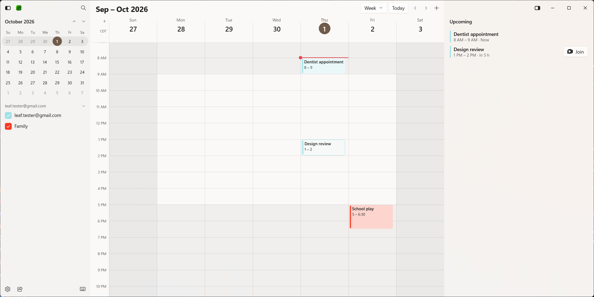

# Your calendar

Leaf Calendar's main window has four parts. Here's what each one does.

## The title bar

From left to right:

- **Sidebar button** (top-left corner) shows or hides the sidebar.
- **Back** shows up when there's somewhere to go back to, like after opening a search result.
- **Search** (the magnifying glass) opens the [command menu](../command-menu/).
- **The period on screen**, like "Sep – Oct 2026".
- **View picker** switches between Day, Week, Month, and your custom number of days.
- **Today** jumps back to today.
- **Previous** and **Next** move back or ahead one day, week, or month, depending on the view.
- **Create event** (the plus) starts a new event.
- **Sync status** only shows when something needs your attention: changes waiting to send, no connection, or a change to review. Hover over it for details. See [Offline and sync](../offline-and-sync/).
- **Details panel** shows or hides the right panel.

The window's title is the date range on screen, so the taskbar always tells you where you are.

## The sidebar

The mini month, your accounts and their calendars, and buttons for search, share availability, keyboard shortcuts, and Settings. See [Sidebar and calendars](sidebar/).

## The calendar

The day, week, or month you're looking at. Drag on it to create an event, click an event to see its details, and drag events to move them. See [Views and navigation](views/) and [Events](../events/).

## The details panel

The right side of the window:

- With nothing selected, it lists your **upcoming** meetings for the next few hours, each with a **Join** button when it has a meeting link. Change how far ahead it looks in **Settings › General › Upcoming meetings**.
- With an event selected, it shows the event's [details](../events/details/).
- While you create or edit an event, it holds the [event editor](../events/editing/).
- While you [share availability](../people-and-scheduling/share-availability/), it holds the times you're sharing.

Press **Esc** to clear the selection or close the panel's current view.
